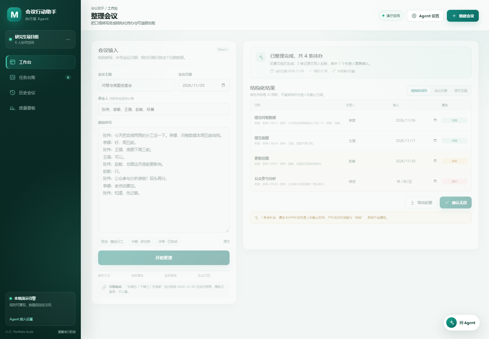
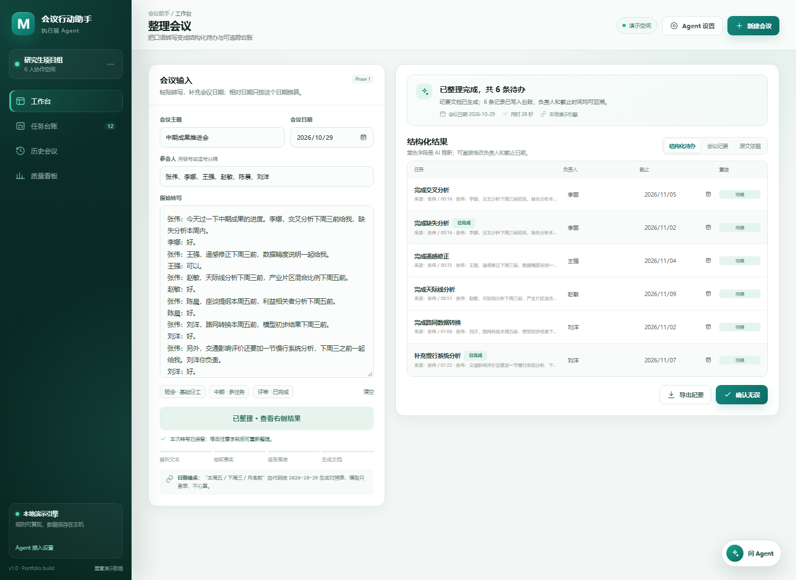
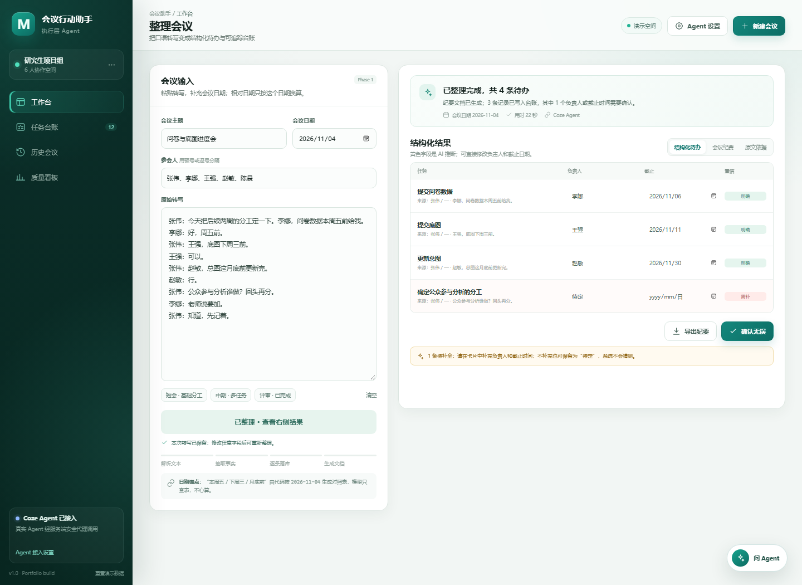

# 会议行动助手 Web · 优化版

把会议转写整理成结构化待办，并继续管理负责人、截止时间、状态、查询与关单回执。

## 直接运行

```powershell
cd D:\桌面\网页优化版
node server.mjs
```

浏览器打开：`http://localhost:4174`

无需安装依赖。数据保存在浏览器 `localStorage`，可在页面左下角重置。

直接双击 **`启动会议助手.cmd`**。脚本会自动找到 Node、启动本地服务并打开浏览器；服务已经运行时只会重新打开页面。

不要双击 `index.html`。`file://` 方式会拦截 ES 模块和 `/api` 接口，页面只剩静态外壳，无法操作。





## 已实现的 Phase 1 能力

- 粘贴会议转写，补充会议主题、日期和参会人
- 四步处理反馈：解析文本 → 抽取事实 → 逐条落库 → 生成文档
- 整理完成后保留原始转写；同一份内容不会重复落库，修改字段后才允许再次整理
- 左侧输入区固定运行栏：长文本滚动时“开始整理”始终可见
- 悬停结构化任务时，左侧自动定位原文并高亮依据句
- 结构化待办：任务、负责人、截止日期、置信度、原文依据
- 负责人和截止日期可在结果卡片内直接修正；修改后转为“人工确认”
- 任务台账：跨会议查询、逾期 / 本周 / 待定 / 已完成筛选、状态更新
- 标记完成前二次确认，避免误关单
- 历史会议：回看纪要、结构化结果和原始依据
- 历史会议支持单场删除：二次确认后同步移除该会议及关联任务，不可恢复
- Agent 对话：按负责人查询、本周到期、待补字段、唯一命中关单
- 关单回执：只有唯一命中才给出确认动作，确认后写状态并返回任务 ID
- 导出 Markdown 纪要
- 质量看板：任务量、状态分布、负责人负载与验收红线
- 质量看板强化：P95 目标提示、放大的未完成数、四项绿色验收勾选

## 可选：接入真实 Coze Agent

1. 在 Coze 打开你的智能体，选择发布，并添加 **API / Bot as API** 发布渠道。
2. 在 Coze 开放平台创建个人访问令牌（以 `pat_` 开头），确保它属于智能体所在工作空间，并有调用 Bot / Chat 的权限。
3. 从智能体页面 URL 或发布信息中复制 Bot ID。不要把工作流 ID、插件 ID 当作 Bot ID。
4. 复制 `.env.example` 为 `.env`，只在本机填写：

```env
COZE_API_TOKEN=pat_xxx
COZE_BOT_ID=7695371178416160822
COZE_API_BASE=https://api.coze.cn
```

> 国内版 Coze 使用 `https://api.coze.cn`；国际版使用 `https://api.coze.com`。
> 当前项目调用的是 Coze Chat API，不使用 Coze Web Chat SDK。项目需要的是 `pat_` 个人访问令牌，不是 `cli_` 开头的 OAuth 客户端 ID 与 Secret。

5. 重启服务：

```powershell
node server.mjs
```

6. 打开 `http://localhost:4174/api/health`，应看到 `"agent": true` 和 `"mode": "coze"`。页面左下角会显示“Coze Agent 已接入”，默认自动使用 Coze；如果手动切到本地，可在“Agent 设置”中切回。



令牌只在 Node 服务端读取，不会进入浏览器代码。真实调用路径：

```text
浏览器 → /api/agent → Node 服务 → Coze Chat API → JSON 结构化结果
```

如果远程 Agent 不可用，页面会提示并自动回落本地演示引擎，不阻断演示。

常见失败原因：智能体尚未发布到 API 渠道、Bot ID 填错、令牌无对应工作空间权限、国内/国际 API 域名不匹配，或智能体输出了 JSON 之外的说明文字。

## 部署

项目包含 `Dockerfile` 与 `render.yaml`，可以部署到任意支持 Node 20+ 的容器或 PaaS。部署后在平台环境变量中配置 `COZE_API_TOKEN` 与 `COZE_BOT_ID`，不要在浏览器端或仓库里保存 Token。

## 测试

```powershell
node --test tests/engine.test.mjs
```

覆盖日期锚点换算、任务抽取、来源引用、Markdown 导出和唯一命中关单。

## 作品集说明

面试讲解、架构取舍、演示路径与高频追问见：

- [`docs/web-case-study.md`](docs/web-case-study.md)

## 目录

```text
index.html          页面入口
styles.css          工作台与各视图样式
js/app.js           状态、渲染、交互、任务维护
js/engine.js        日期归一化、任务抽取、查询与文档生成
js/data.js          脱敏演示会议与任务
js/api.js           服务端 Agent 调用
server.mjs          静态服务 + Coze 代理
tests/              引擎单测
```

## 边界

- 这是个人项目演示，15 段脱敏转写与构造用例用于回归，不是线上经营数据。
- 落库一致率 100% 指系统不丢行，不等于模型抽取召回 100%。
- 卡片批量确认、置信度模型、长文本分块、权限审计和原生日程同步属于 Phase 2。
