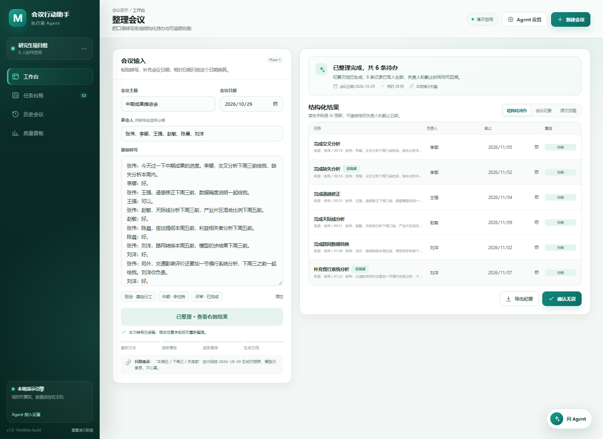
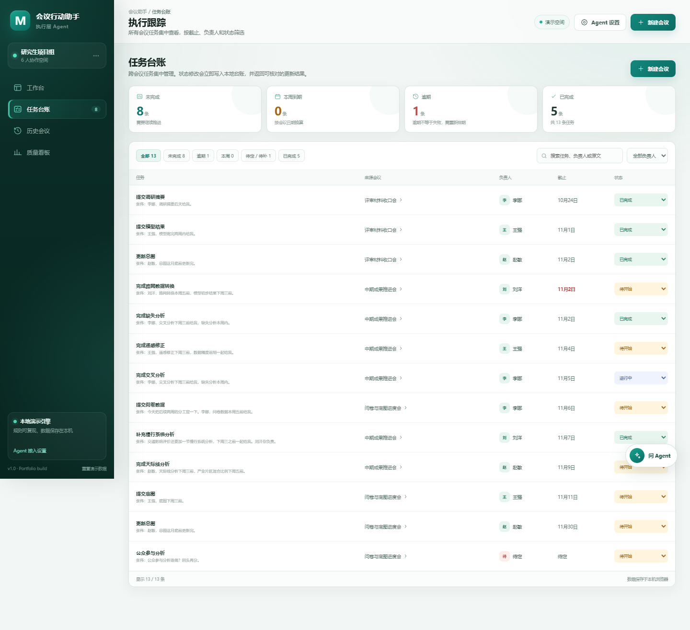
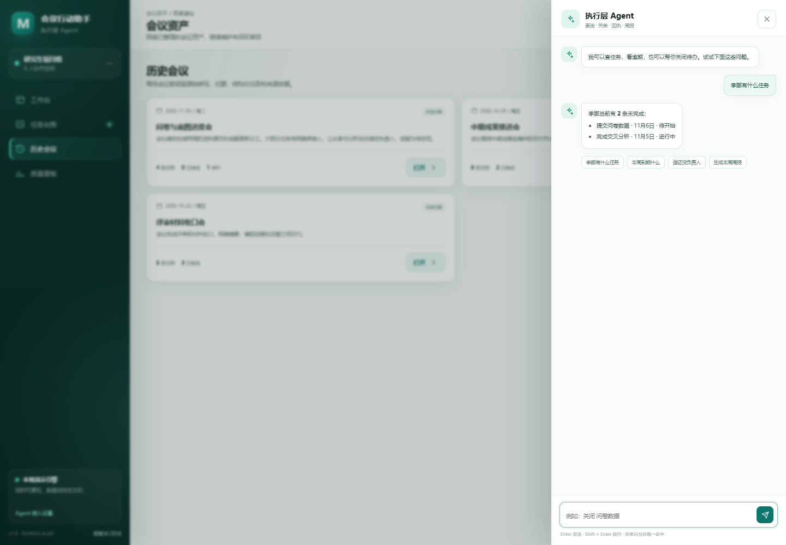
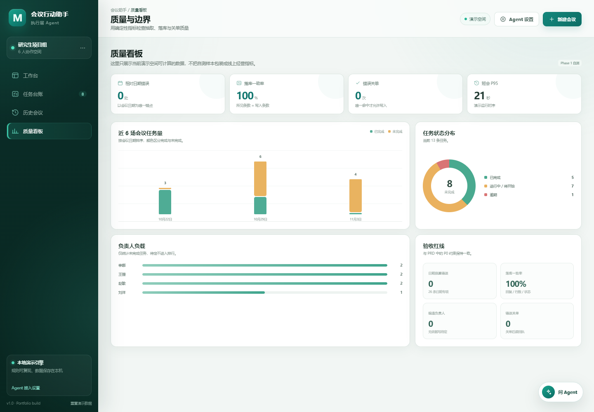

# 会议行动助手 Web 版：作品集案例说明

## 一句话定位

把 40 分钟的会后人工整理压缩到 3 分钟内，并把“会议记录”推进到“任务可追踪、可修改、可关单、有回执”的执行层。

这不是转写工具的替代品。转写由飞书妙记、腾讯会议等成熟产品完成；本项目从转写文本开始，解决会后任务丢失、责任不清、状态不可追踪的问题。

## 为什么从 Coze Agent 扩展到 Web

只做聊天框可以证明大模型能抽取待办，但不能证明 B 端业务闭环成立。真实使用者会继续追问四件事：

1. 抽错了在哪里改？
2. 任务散落在不同会议里，怎么统一查看？
3. 口头说“这件事完成了”，系统能不能只改那一条？
4. 写入后有没有回执，怎么证明对话、数据库和页面一致？

Web 版补齐的正是这四层：可视化核对、跨会议台账、受控关单、写入回执。

## Phase 1 范围

本期只做一条可演示、可验收的闭环：

```text
粘贴转写 → 结构化抽取 → 人工核对 → 写入任务台账
→ 查询/筛选 → 唯一命中关单 → 返回写入回执
```

Phase 1 不做：语音转写、企业权限体系、原生飞书日历同步、长文本自动分块、复杂审批流。

## 页面与能力

### 工作台

- 左侧输入会议主题、会议日期、参会人和原始转写。
- 右侧展示结构化待办、会议纪要、原文依据。
- 负责人和截止日期可直接修改；修改后置信度变为“人工确认”。
- 整理成功后保留本次输入，同一份内容不会重复写入台账。



### 任务台账

- 跨会议汇总所有任务。
- 支持逾期、本周、待定、已完成、全部等筛选。
- 支持按负责人过滤和关键字搜索。
- 状态可更新为未开始、进行中、已完成。



### Agent 对话

- 查询某人的任务、本周到期任务、待补字段任务。
- 关单必须先唯一命中，再二次确认。
- 写入后返回任务 ID、更新行数和最终状态。



### 质量看板

- 展示任务量、状态分布、负责人负载。
- 把验收红线直接产品化，而不是只写在 PRD 里。



## 系统架构

```text
浏览器工作台
  ├─ 静态 HTML / CSS / ES Modules
  ├─ localStorage：个人演示数据
  └─ /api/agent
        ↓
Node 静态服务与安全代理
  ├─ 本地演示引擎：规则抽取、日期换算、查询、关单
  └─ Coze Chat API：可选真实 Agent
        ↓
结构化 JSON
  ├─ tasks[]：任务、负责人、截止、置信度、原文依据
  └─ minutes：摘要、结论、风险、悬而未决
```

关键取舍：

- Token 只存在 Node 服务端，不进入浏览器。
- 本地引擎保证无网络、无 Token 时也能确定性演示。
- Coze 不可用时自动回落本地引擎，不阻断完整流程。
- 前端零依赖，降低部署和现场演示失败率。

## AI 抽取策略

### 宽抽取 + 严审核

- 先尽量找全任务，避免漏记。
- 每条任务必须带原文出处 `sourceQuote`。
- 无明确负责人或截止依据时写“待定”，不允许模型自行猜测。
- 抽取后再合并重复项、剔除没有承接动作的闲聊。

### 日期锚点

“本周五”“下周三”“月底前”都由代码以会议日期为唯一锚点换算，再交给模型查表。模型不负责心算日期。

这条规则用于规避大模型最常见的相对日期错误，也对应验收红线：相对日期换算错误 0 处。

### 置信度分层

- 明确：原文直接给出负责人和日期。
- 推断：日期来自上下文推断，需要人工复核。
- 待补：负责人或日期无依据，保留“待定”。
- 人工确认：用户已手工修改。

置信度不是为了炫技，而是告诉用户“哪里最值得先看”。

## 兜底机制

| 失败场景 | 产品处理 |
|---|---|
| Coze 未配置或请求失败 | 页面提示并自动切回本地演示引擎 |
| 模型返回非 JSON | 服务端尝试提取 JSON；仍失败则返回可诊断错误并回落 |
| 同一份转写重复点击 | 按钮进入“已整理”状态，阻止重复落库 |
| 任务负责人/日期无依据 | 写“待定”，不编造，界面标记待补 |
| 用户批量关单 | 拒绝直接执行，要求逐条唯一命中 |
| 关单匹配多条 | 不写入，列出候选并要求指定 |
| 对话已关单但台账未变 | 用同一数据源更新后统一重渲染，回执带任务 ID 与行数 |

## 验收证据

Phase 1 当前已验证：

- 引擎单测 5/5 通过。
- 示例“中期 · 多任务”可生成 6 条待办。
- 相对日期按所选会议日期换算。
- 修改负责人后，置信度变为“人工确认”。
- Agent 查询返回真实台账数据。
- 唯一命中关单返回确认，确认后写入并显示任务 ID。
- 桌面端和 390px 移动端均无横向溢出。
- 处理完成后保留转写，按钮变为“已整理 · 查看右侧结果”。

质量指标定义：

- 端到端响应 P95 ≤ 30 秒：从点击整理到结果可操作。
- 数据落库一致率 100%：系统写入不丢行，不等于模型召回 100%。
- 错误关单 0 次：非唯一命中不得写入。
- 编造字段 0 处：无原文依据必须写“待定”。

## 面试演示路径

建议 90 秒内完成主线，不逐页念功能：

1. 点击“中期 · 多任务”，展示会议日期和转写。
2. 点击“开始整理”，指出四步链路：解析文本、抽取事实、逐条落库、生成文档。
3. 在结果中修改一条负责人，说明置信度从 AI 推断转为“人工确认”。
4. 打开任务台账，筛选本周任务，说明跨会议执行视图。
5. 打开 Agent，输入“关闭 公众参与分析”，先出现确认，再执行并返回任务 ID。
6. 打开质量看板，收束到“确定性”和“可追溯”。

## 高频追问

### 为什么不用现成的飞书妙记？

妙记解决记录和摘要，本项目解决会后任务闭环。两者是上下游关系，不是替代关系。

### 为什么不是一个纯 Prompt？

纯 Prompt 可以生成文本，但无法保证日期锚点、落库一致、唯一命中关单和写入回执。Web 版把模型能力放进受控业务流。

### 为什么保留本地引擎？

现场演示需要确定性；评测需要可重复基线；Coze 故障时业务不能中断。真实 Agent 接入后，产品结构不变，只替换抽取节点。

### 这个项目的核心壁垒是什么？

不是“会调用大模型”，而是把不确定的模型输出约束成可验收的业务动作：出处、锚点、置信度、唯一命中、二次确认、回执一致。

## 后续规划

- Phase 2：长文本分块、批量确认、飞书/企微原生日程同步、企业权限审计。
- Phase 3：任务负责人主动提醒、周报自动汇总、跨项目依赖识别。

